# Отчёт по DO5_SimpleDocker

## Part 1. Ready-made docker

- Загружен официальный Docker-образ `nginx` командой `docker pull nginx`.
- Проверено наличие образа с помощью `docker images`.
- Создан и запущен контейнер на основе nginx; состояние проверено через `docker ps`.
- Через `docker inspect` определены параметры контейнера, включая размер, IP-адрес и порты.
- Контейнер остановлен, затем повторно запущен с публикацией портов `80:80` и `443:443`.
- Доступность nginx проверена в браузере по адресу `localhost:80`.
- Контейнер перезапущен и его рабочее состояние повторно проверено.

- **Скриншот 1 — Загрузка официального образа nginx и проверка списка локальных Docker-образов.**

  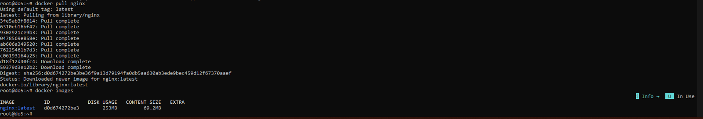

- **Скриншот 2 — Создание контейнера nginx и проверка его состояния командой docker ps.**

  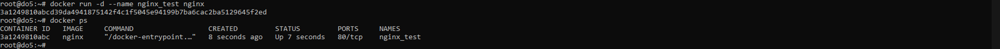

- **Скриншот 3 — Полный вывод docker inspect для созданного контейнера.**

  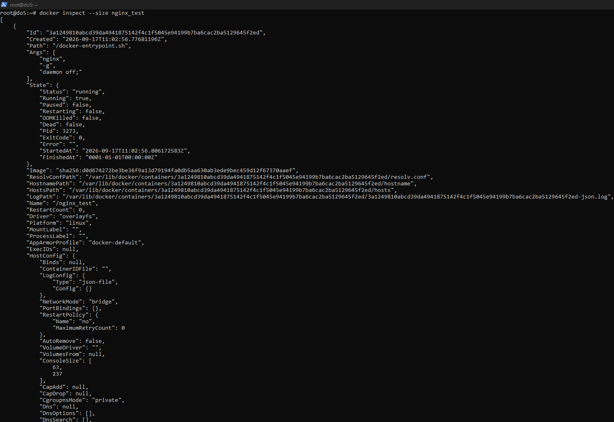

- **Скриншот 4 — Вывод основных параметров контейнера: размер, IP-адрес и открытые порты.**

  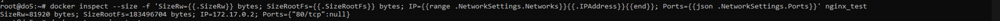

- **Скриншот 5 — Остановка контейнера и проверка отсутствия запущенного контейнера.**

  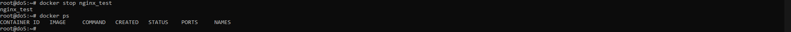

- **Скриншот 6 — Повторный запуск nginx с публикацией портов 80 и 443.**

  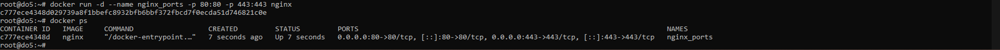

- **Скриншот 7 — Стандартная стартовая страница nginx, доступная через localhost:80.**

  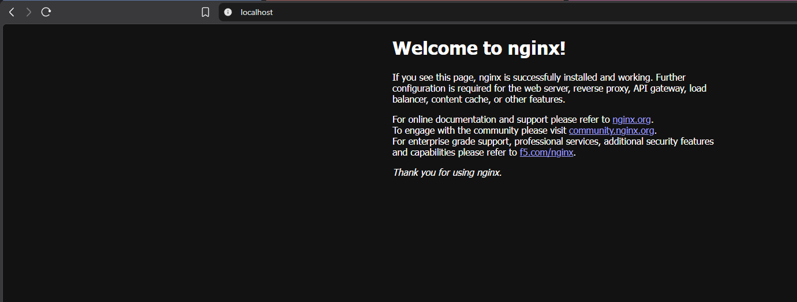

- **Скриншот 8 — Перезапуск контейнера и контроль его рабочего состояния.**

  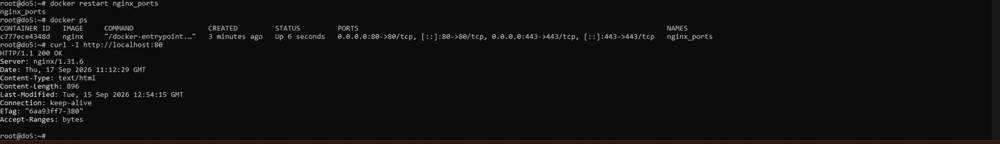

## Part 2. Operations with container

- Содержимое `/etc/nginx/nginx.conf` прочитано внутри контейнера через `docker exec`.
- На локальной машине создан новый `nginx.conf` с обработчиком `/status` и директивой `stub_status`.
- Новый конфигурационный файл скопирован в контейнер командой `docker cp`, синтаксис проверен через `nginx -t`.
- nginx перезагружен, а `localhost:80/status` проверен через `curl` и браузер.
- Контейнер экспортирован в `container.tar`, после чего исходный контейнер и образ удалены.
- Из `container.tar` создан новый Docker-образ через `docker import`.
- На основе импортированного образа запущен новый контейнер и повторно проверена страница `/status`.

- **Скриншот 1 — Чтение исходного nginx.conf внутри контейнера командой docker exec.**

  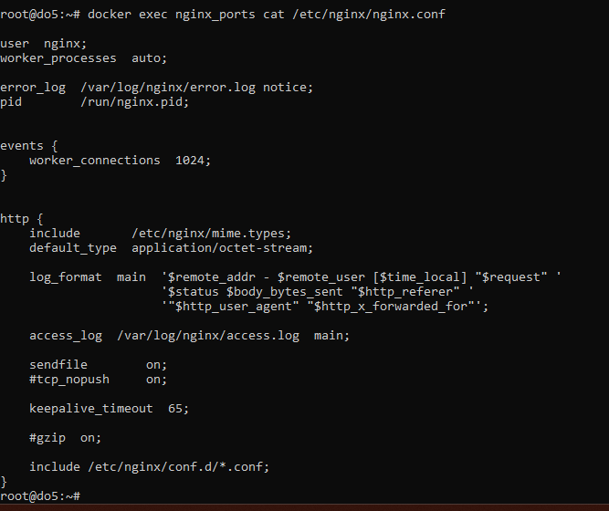

- **Скриншот 2 — Создание локального nginx.conf с обработчиком /status.**

  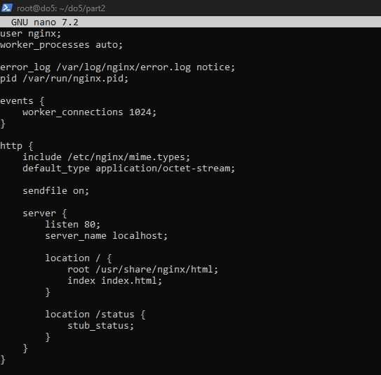

- **Скриншот 3 — Копирование нового nginx.conf в контейнер и проверка конфигурации nginx.**

  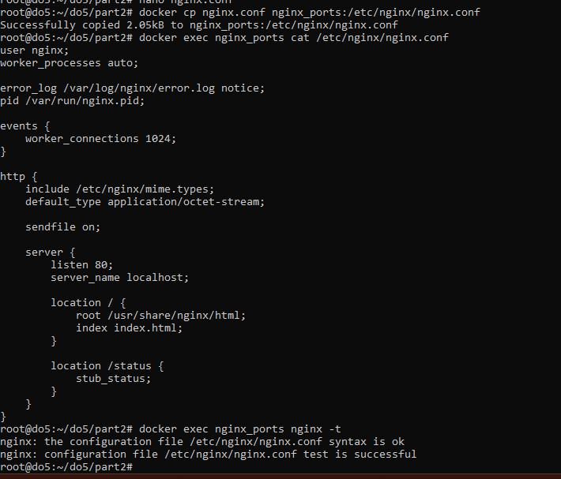

- **Скриншот 4 — Перезагрузка nginx и проверка страницы /status через curl.**

  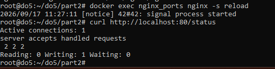

- **Скриншот 5 — Проверка адреса localhost:80/status в браузере.**

  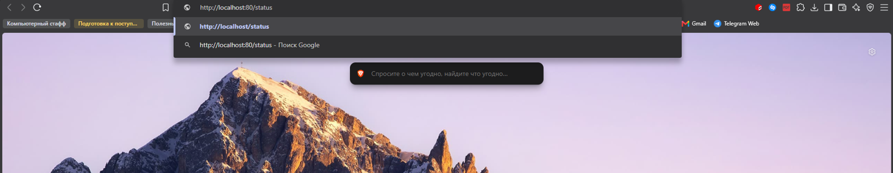

- **Скриншот 6 — Страница nginx status, открытая в браузере.**

  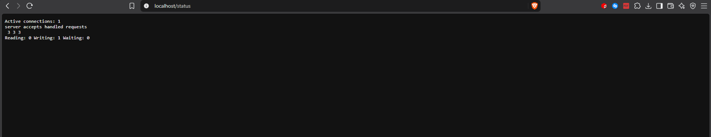

- **Скриншот 7 — Остановка исходного контейнера перед экспортом и удалением.**

  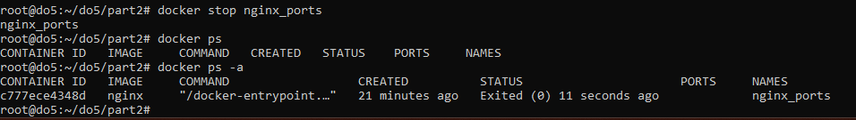

- **Скриншот 8 — Экспорт контейнера и подготовка к удалению исходного образа.**

  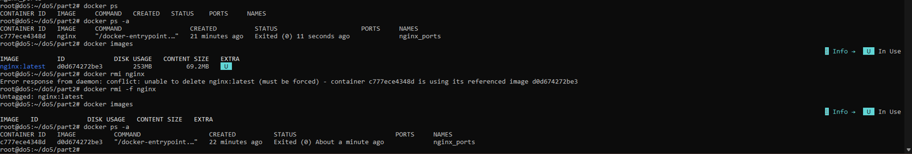

- **Скриншот 9 — Удаление исходного образа после остановки контейнера.**

  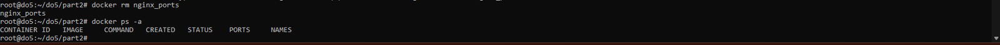

- **Скриншот 10 — Удаление остановленного контейнера.**

  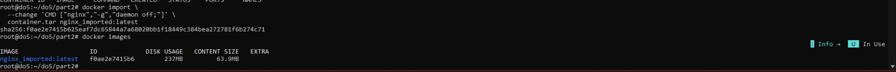

- **Скриншот 11 — Импорт container.tar в новый Docker-образ.**

  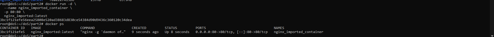

- **Скриншот 12 — Запуск контейнера на основе импортированного образа и повторная проверка /status.**

  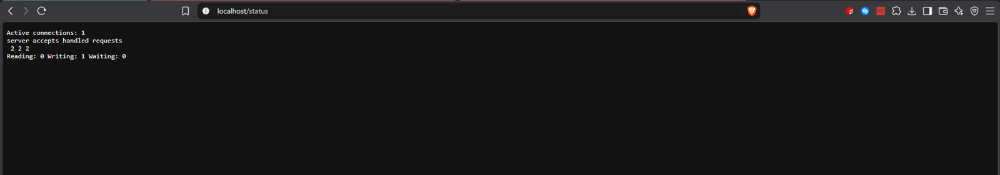

## Part 3. Mini web server

- Исходный код мини-веб-сервера на C с использованием FastCGI размещён в `src/server/server.c`.
- Сервер собран с библиотекой FastCGI и запущен через `spawn-fcgi` на порту `8080`.
- Создан `src/nginx/nginx.conf`, который принимает запросы на порту `81` и передаёт их FastCGI-серверу `127.0.0.1:8080`.
- Конфигурация nginx проверена перед запуском.
- Через `curl` и браузер подтверждено, что `localhost:81` возвращает страницу `Hello, World!`.

- **Скриншот 1 — Исходный код мини-веб-сервера на C с использованием FastCGI.**

  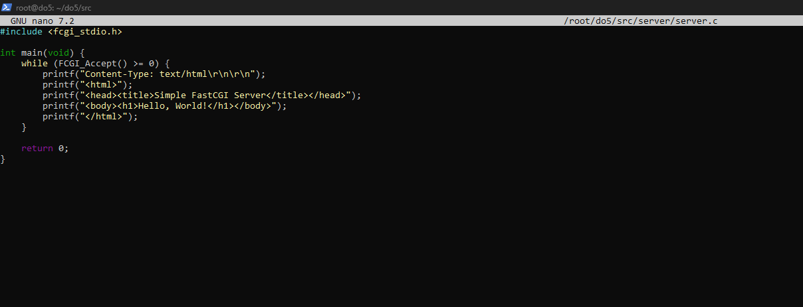

- **Скриншот 2 — Компиляция FastCGI-сервера, запуск через spawn-fcgi на порту 8080 и проверка прослушивания порта.**

  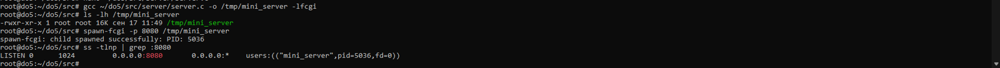

- **Скриншот 3 — Конфигурация nginx для проксирования запросов на FastCGI-сервер 127.0.0.1:8080.**

  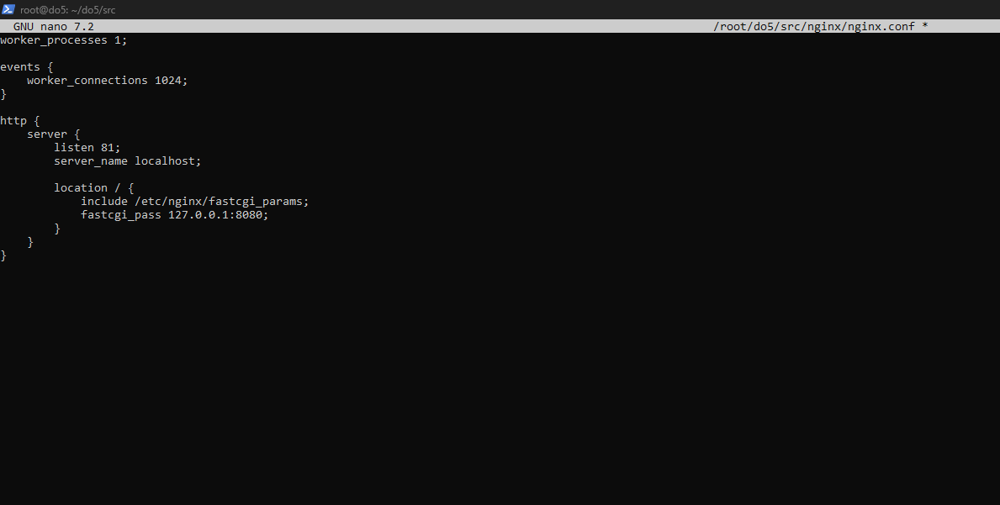

- **Скриншот 4 — Проверка синтаксиса созданного nginx.conf.**

  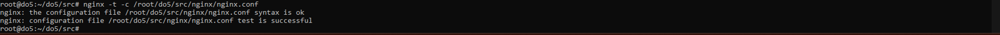

- **Скриншот 5 — Запуск nginx с созданной конфигурацией и проверка ответа через curl.**

  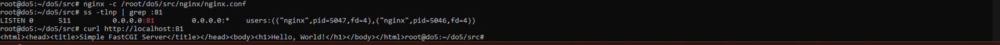

- **Скриншот 6 — Ввод адреса localhost:81 перед браузерной проверкой мини-сервера.**

  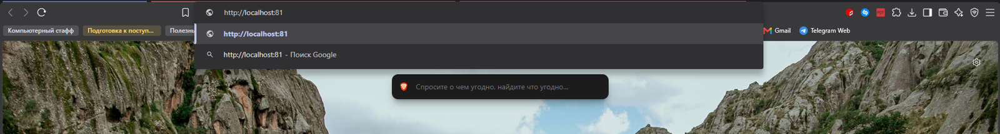

- **Скриншот 7 — Страница Hello, World! мини-веб-сервера в браузере.**

  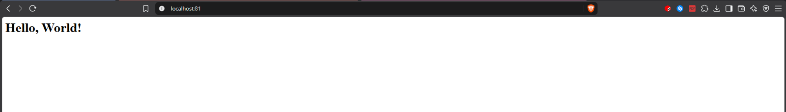

## Part 4. Your own docker

- Создан собственный `Dockerfile`, который устанавливает зависимости, собирает FastCGI-сервер, копирует `nginx.conf` и запускает nginx вместе с сервером.
- Образ собран под именем `simple-server:1.0`.
- Контейнер запущен с публикацией порта `80` хоста на порт `81` контейнера; страница `Hello, World!` проверена через `localhost:80`.
- В nginx добавлен путь `/status` с `stub_status`.
- После изменения конфигурации образ пересобран, контейнер перезапущен, а `localhost:80/status` проверен из терминала и браузера.

- **Скриншот 1 — Конфигурация nginx, используемая собственным Docker-образом.**

  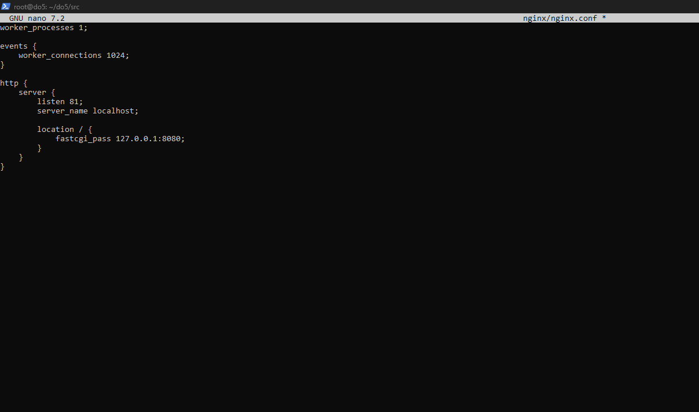

- **Скриншот 2 — Dockerfile для сборки и запуска FastCGI-сервера вместе с nginx.**

  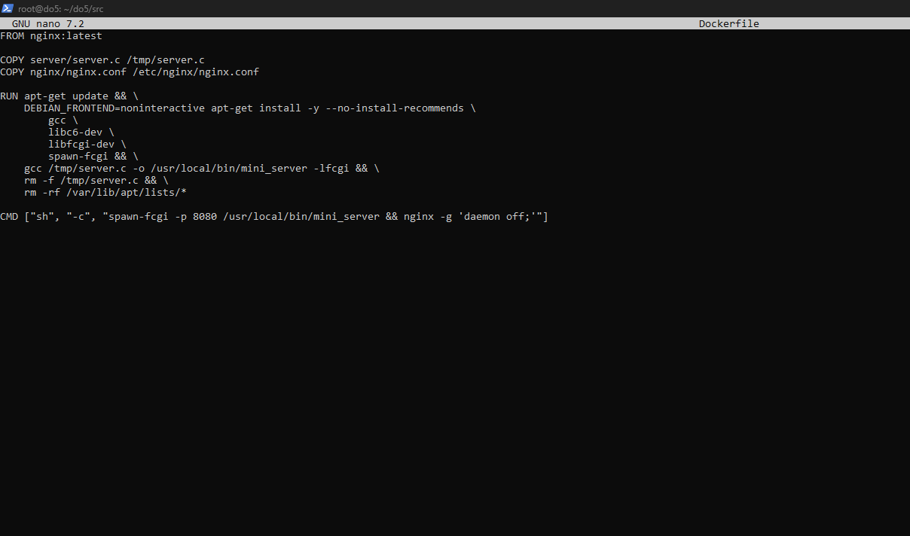

- **Скриншот 3 — Сборка собственного Docker-образа simple-server:1.0.**

  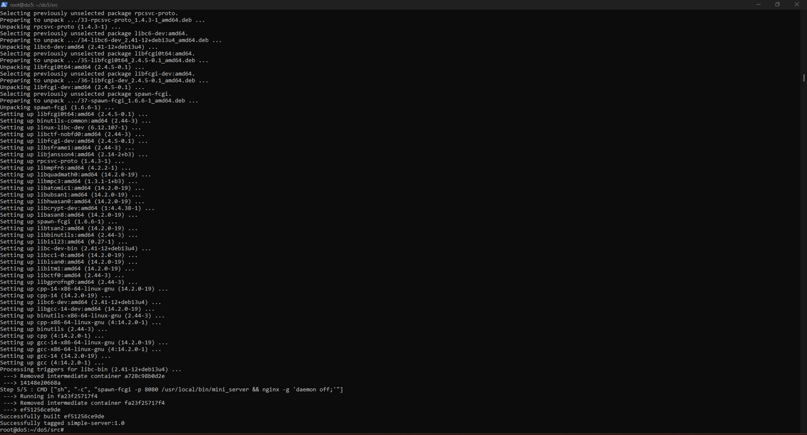

- **Скриншот 4 — Проверка созданного образа, запуск контейнера и обращение к опубликованному порту.**

  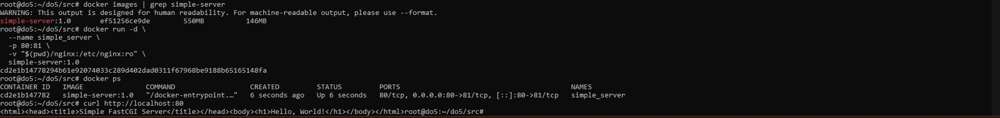

- **Скриншот 5 — Страница Hello, World! из собственного Docker-образа.**

  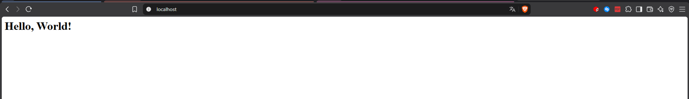

- **Скриншот 6 — Изменение nginx.conf: добавление location /status со stub_status.**

  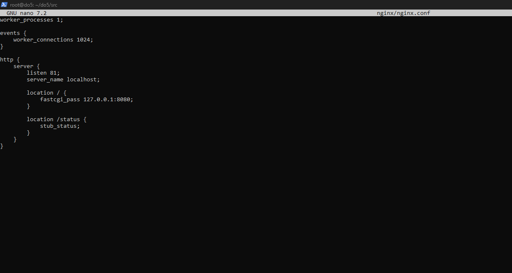

- **Скриншот 7 — Повторная сборка Docker-образа после изменения конфигурации.**

  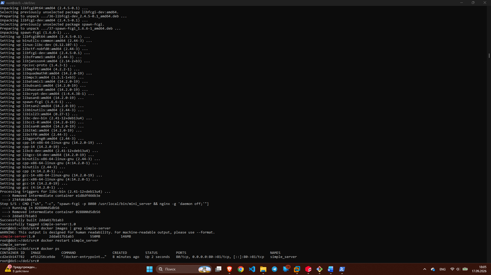

- **Скриншот 8 — Перезапуск контейнера после обновления образа.**

  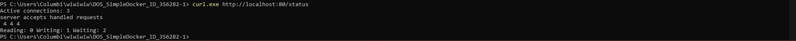

- **Скриншот 9 — Проверка /status из терминала после перезапуска контейнера.**

  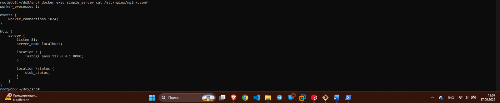

- **Скриншот 10 — Страница nginx status, открытая в браузере на localhost:80/status.**

  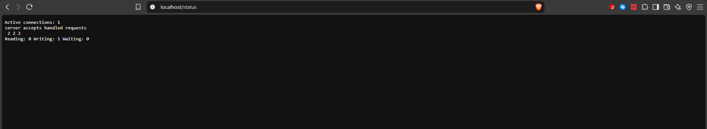

## Part 5. Dockle

- Выполнена первоначальная проверка `simple-server:1.0` утилитой Dockle; были обнаружены уровни `FATAL` и `WARN`.
- Dockerfile доработан: базовый образ изменён на `debian:bookworm-slim`, добавлен непривилегированный пользователь `appuser`, а также `HEALTHCHECK`.
- Исправленный Docker-образ успешно пересобран.
- После повторной проверки Dockle уровни `FATAL` и `WARN` отсутствуют; остались только информационные рекомендации `INFO`.

- **Скриншот 1 — Первоначальная проверка simple-server:1.0 утилитой Dockle: обнаружены FATAL и WARN.**

  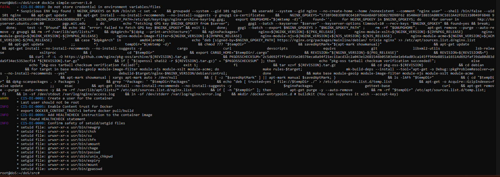

- **Скриншот 2 — Исправленный Dockerfile и конфигурация nginx после замечаний Dockle.**

  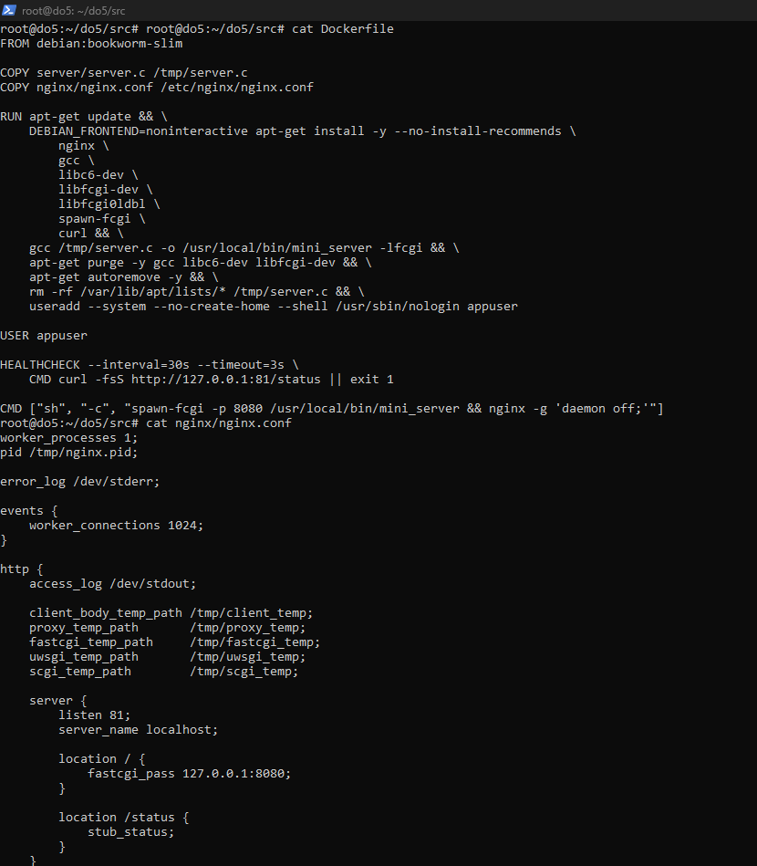

- **Скриншот 3 — Успешная пересборка исправленного Docker-образа.**

  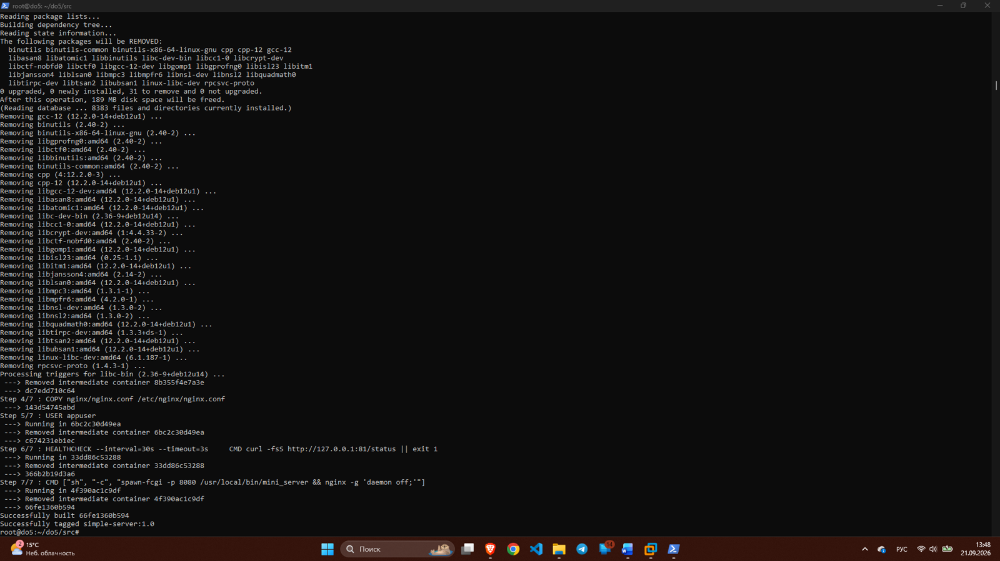

- **Скриншот 4 — Финальная проверка Dockle: FATAL и WARN отсутствуют, остались только INFO.**

  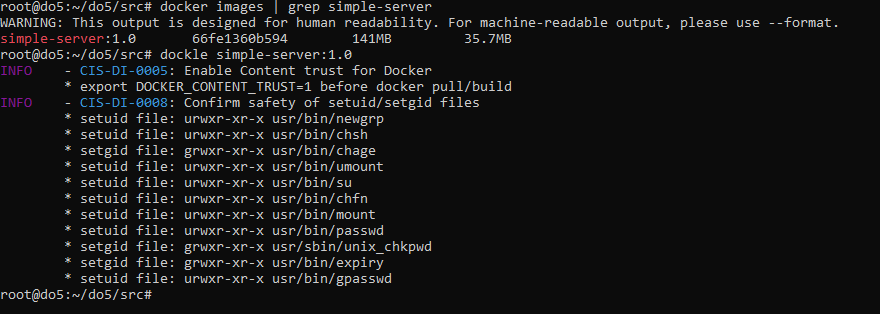

## Part 6. Basic Docker Compose

- Проверена доступность Docker Compose и остановлены ранее запущенные контейнеры.
- Создан `src/nginx_proxy/default.conf` для второго контейнера nginx: он принимает запросы на порту `8080` и проксирует их в сервис приложения на порт `81`.
- Создан `src/docker-compose.yml` с двумя сервисами: `server` на основе собственного образа и `proxy` на основе nginx.
- Первый контейнер работает только во внутренней Docker-сети и не публикует порт на хост.
- Второй контейнер публикует порт `80` хоста в порт `8080` контейнера.
- Проект собран командой `docker compose build` и запущен командой `docker compose up -d`.
- `docker compose ps` подтвердил рабочее состояние обоих сервисов; запрос к `localhost:80` возвращает `Hello, World!`.
- Финальная работа двухконтейнерной схемы подтверждена в браузере.

- **Скриншот 1 — Проверка Docker Compose и остановка ранее запущенных контейнеров.**

  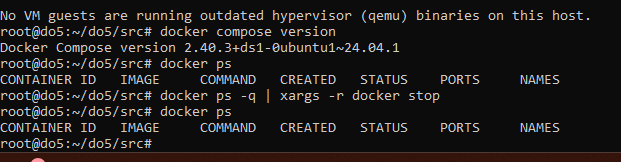

- **Скриншот 2 — Конфигурация nginx proxy, принимающего запросы на 8080 и перенаправляющего их в первый сервис.**

  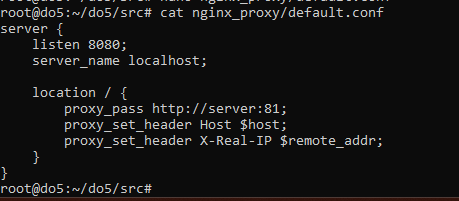

- **Скриншот 3 — docker-compose.yml с сервисами server и proxy и общей внутренней Docker-сетью.**

  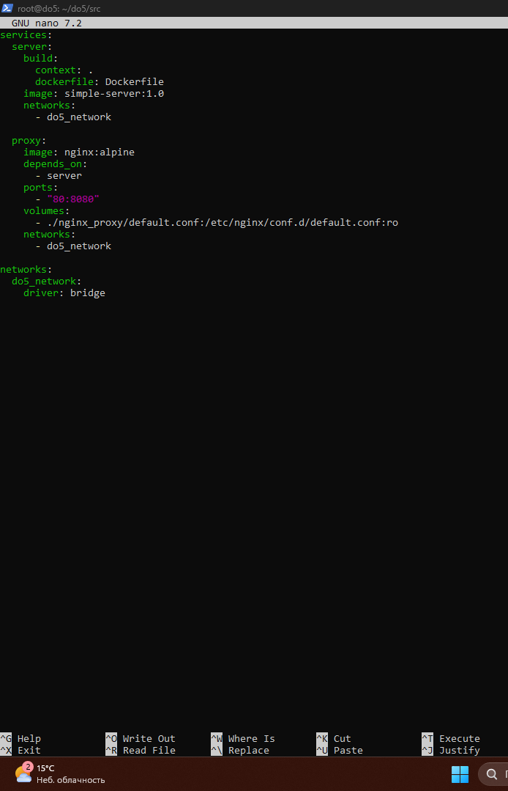

- **Скриншот 4 — Успешная сборка проекта командой docker compose build.**

  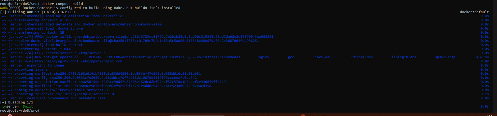

- **Скриншот 5 — Запуск сервисов Docker Compose и загрузка необходимых слоёв nginx.**

  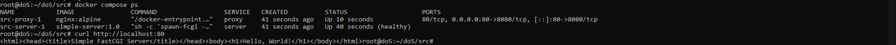

- **Скриншот 6 — Проверка обоих сервисов через docker compose ps и успешный ответ Hello, World! через curl.**

  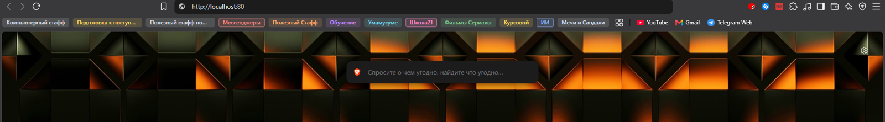

- **Скриншот 7 — Финальная страница Hello, World! через nginx-proxy Docker Compose.**

  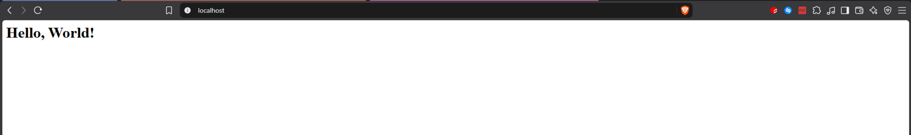
